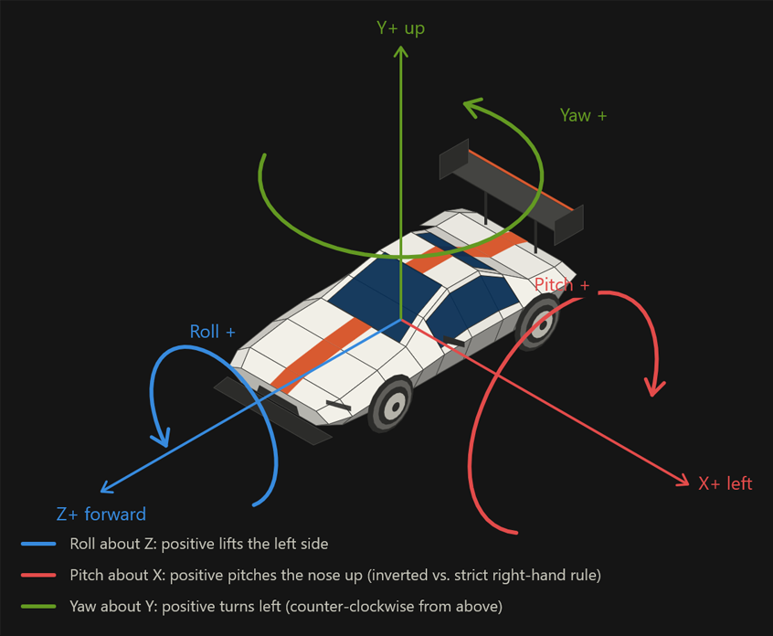

# Coordinate System & Telemetry Conventions

### Coordinate System & Telemetry Conventions

To ensure seamless integration for third-party plugins, custom device managers, and telemetry parsers, OpenSR adheres to a standardized **Right-Handed Coordinate System**.

All incoming telemetry and motion data must be normalized to match these conventions before being processed by kinematic solvers or device controllers OUT plugins.

### 1. Axis Orientation (Cartesian Space)

When viewed from the driver’s perspective inside the vehicle:

- **X+ = Left** (Lateral axis: positive values indicate movement or force to the left)
- **Y+ = Up** (Vertical axis: positive values indicate upward movement or elevation)
- **Z+ = Forward** (Longitudinal axis: positive values indicate forward acceleration or movement)

### 2. Rotational Conventions (Right-Hand Rule)

Rotations follow the right-hand rule relative to the vehicle’s axes:

- **Roll (Rotation around Z – Forward):**
- Positive rotation (Roll > 0) lifts the **left** side of the chassis.
- *Note for plugins:* If the right side of the car rises (e.g., during a right-hand turn load transfer), the resulting roll value must be negative (Roll < 0).
- **Pitch (Rotation around X – Left):**
- Positive rotation (Pitch > 0) pitches the nose of the car up.
- **Yaw (Rotation around Y – Up):**
- Positive rotation (Yaw > 0) turns the vehicle to the left (counter-clockwise from a top-down view). Same direction for yaw-rate.

Pitch is the one exception to the pure right-hand rule: positive pitch = nose up (equivalent to a negative rotation about X).

### 3. Guidelines for Third-Party Plugin Developers

If you are developing a telemetry plugin or integrating an external kinematic engine (such as a 6DOF Stewart platform solver) that uses a differing internal coordinate convention:

1. **Check Sign Mismatches:** If your solver or hardware outputs inverted motion compared to the core software standard, apply a **-1 multiplier (inversion)** specifically to the affected axes (typically Pitch and Roll) during your plugin’s data normalization phase.
2. **Do Not Alter Base Axes:** Keep the primary X+ = left definition intact to maintain compatibility with downstream rendering and motion cueing filters.
