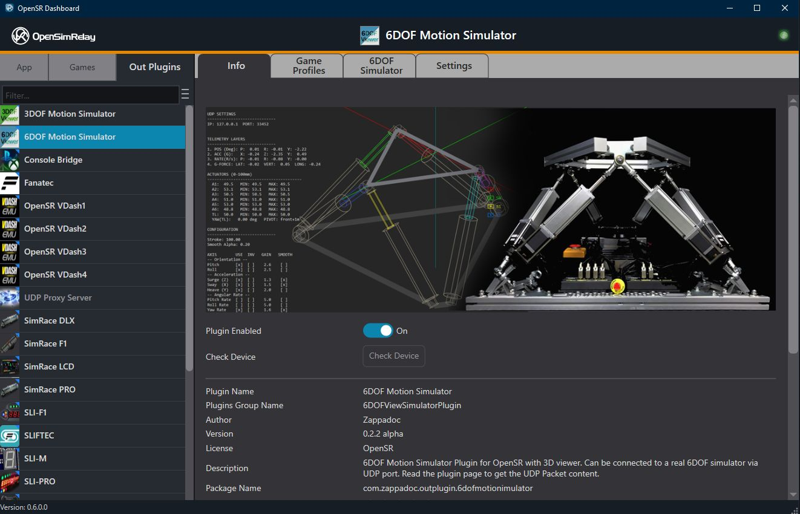
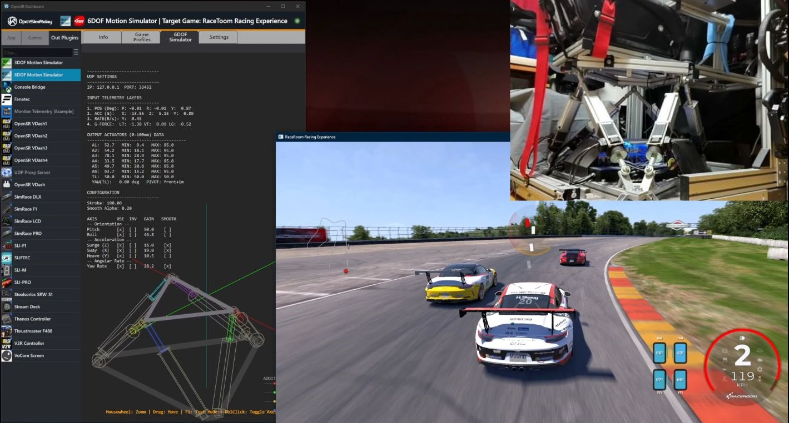
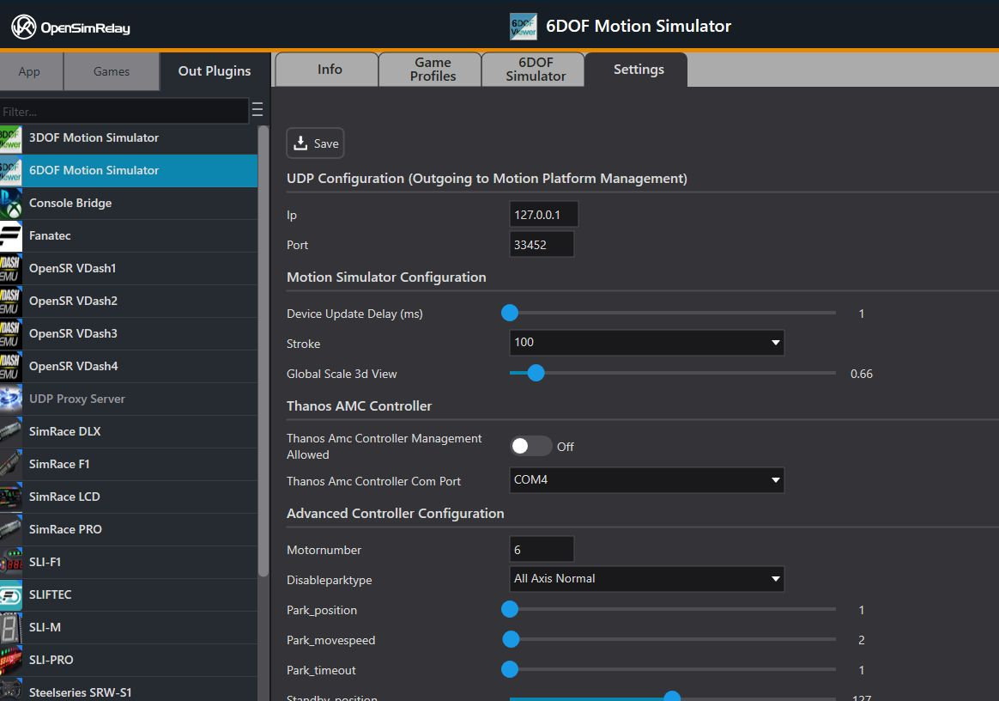
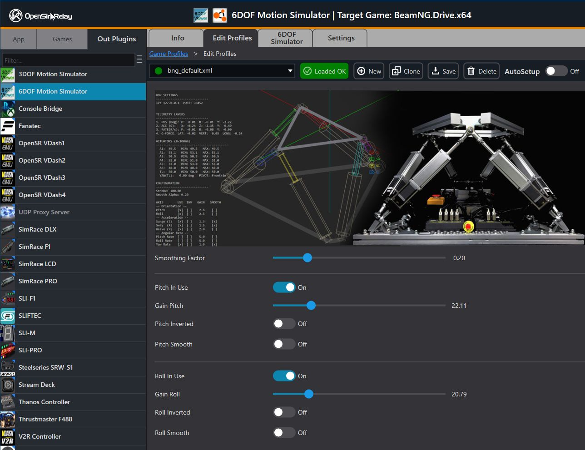
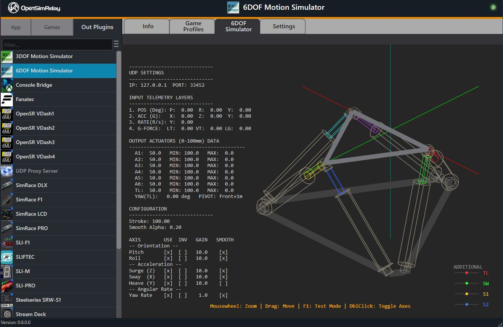

### 6DOF Motion Simulator Plugin for OpenSR

[](assets/2026-10-28_OpenSR_6DOF_motion_plugin_info.jpg)

**Version:** 0.2.2 alpha  
**OpenSR minimum version:** 0.6.0  
**Author:** Zappadoc / EKSIMRacing  
**License:** OpenSR

---

## Overview

[](assets/2026-10-28_OpenSR_6DOF_plugin.jpg)

The 6DOF Motion Simulator plugin connects your sim racing game to a 6-axis Stewart platform motion simulator. It reads motion telemetry from the game, computes the 6 actuator positions, and sends them via UDP to your motion controller hardware. The plugin includes a real-time 3D viewer so you can see exactly what your platform is doing, tune the feel per game, and run a calibration test mode. **Key feature:** The positions sent via UDP are **pre-computed, in millimeters, ready to be applied directly to your actuators.** Your bridge application does not need to run any kinematics , it simply receives target positions and sends them to the hardware.

---

## Features

- 6-axis Stewart platform motion output (A1–A6)
- 4 additional motion channels (TL, SW, SR1, SR2) for extended platforms
- Real-time 3D wireframe viewer with live telemetry HUD
- Per-game profiles with independent gain, smoothing, and invert per axis
- Traction loss effect (rear-break-loose sensation from yaw rate)
- Test mode for hardware calibration (F1 key)
- Saturation detection with visual warning
- Optional direct Thanos AMC Motion Controller support (COM port)
- UDP output at up to 1000 Hz
- Pause detection: platform returns to center when game is paused

---

## Installation

1. Install **OpenSR** or select **Check For Update** to get the latest software.
2. The **6DOF Motion Simulator** plugin is automatically installed with OpenSR.
3. Ensure a supported **IN plugin** (game) is active and providing motion data.
4. Open OpenSR Dashboard → **Out Plugins** → **6DOF Motion Simulator**.

---

## Motion Addon

Developing professional-grade motion simulation software is a significant undertaking. This journey of research and development began in 2018 in collaboration with the FREX company through the development of the MotionMax Manager software. Today, that legacy continues with OpenSR,a completely new engine built from the ground up, integrating years of knowledge in development of high-accuracy kinematics with real-time telemetry. Between the rigorous testing and the extreme cost of the specialized hardware required for development, the project relies on the generosity of the community to remain sustainable and continue evolving.

To support the ongoing development of OpenSR, full-speed UDP motion output is available via the **Motion Addon** access level.

### Access Levels & Eligibility

To ensure the project can continue to provide these tools, UDP packets are transmitted only to authenticated users with the appropriate account access levels.

- **Motion Addon Status:** This status is required for full-speed motion output. You are eligible for this status if:
  - You have contributed **$29 USD / €29 EUR** or more to the OpenSR project.
  - You are a **Premium Access** or **Gold Premium** member.
  - You are a registered user of the **MotionMax Manager** software.
- **Upgrade Paths:** Users with **Basic** (no donation) or **Standard** (contribution of $5 / €5 or more) accounts can upgrade to the Motion Addon status at any time by completing the contribution requirement. [Donate to upgrade your account.](https://www.eksimracing.org/donation/)

### Performance Tiers

For motion to feel smooth and realistic, the system requires a high update rate (typically 60+ positions per second). Access to these rates is tied to your account level:

| Account Level             | Performance  | Access                                                                                                              |
| ------------------------- | ------------ | ------------------------------------------------------------------------------------------------------------------- |
| **Basic / Guest**         | 30 PPS       | **Preview Mode:** Allows you to test the setup and use the 3D viewer.                                               |
| **Standard+ / Signed In** | Up to 500 Hz | **Full Pro Performance:** High-speed and hight-accuracy motion (actual rate depends on the game and your hardware). |

By upgrading to the Motion Addon, you not only unlock the full potential of your hardware but directly support the continued development and maintenance of the OpenSR project.

---

## Configuration

[](assets/2026-10-28_OpenSR_6DOF_plugin_settings.jpg)

### General Settings (Settings tab)

| Setting                  | Default     | Description                                                                       |
| ------------------------ | ----------- | --------------------------------------------------------------------------------- |
| **IP**                   | `127.0.0.1` | Destination IP for UDP. Use your motion controller’s LAN IP if on a different PC. |
| **Port**                 | `33452`     | Destination UDP port.                                                             |
| **Device Update Delay**  | `1 ms`      | Minimum interval between UDP sends. Lower = higher rate.                          |
| **Stroke**               | `100`       | Actuator stroke in mm. Options: 100, 150.                                         |
| **Global Scale 3D View** | `0.66`      | Zoom for the 3D viewer (cosmetic).                                                |

### Thanos AMC Controller (optional)

If you use a Thanos AMC 600 controller, enable it in the Settings tab.

> When the Thanos AMC is enabled, the plugin drives the hardware directly via COM port **in addition to** sending UDP. Disable UDP or point it to a different port if you don’t need both.

---

## Game Profiles

Each game can have its own motion profile. Select or create a profile in the **Game Profiles** tab.

[](assets/2026-10-28_OpenSR_6DOF_plugin_game_profile.jpg)

### Global

| Setting              | Range   | Default | Description                                                |
| -------------------- | ------- | ------- | ---------------------------------------------------------- |
| **Smoothing Factor** | 0.0–1.0 | 0.20    | Global exponential smoothing. Higher = smoother, more lag. |

### Per-Axis Settings

Each axis has four controls:  
Control | Description  
**In Use** | Enable/disable this axis.  
**Gain** | Multiplier (0–500). Scales the input amplitude.  
**Inverted** | Reverses direction (use if motion feels backwards).  
**Smooth** | Apply the global smoothing factor to this axis.

### Available Axes

| Axis          | Source Data               | Effect                            |
| ------------- | ------------------------- | --------------------------------- |
| **Pitch**     | Vehicle pitch (rad)       | Nose up/down                      |
| **Roll**      | Vehicle roll (rad)        | Lean left/right                   |
| **Surge (Z)** | Longitudinal acceleration | Braking dive / acceleration squat |
| **Sway (X)**  | Lateral acceleration      | Cornering lean                    |
| **Heave (Y)** | Vertical acceleration     | Bumps / suspension                |
| **Yaw Rate**  | Yaw angular rate (rad/s)  | Traction loss / oversteer slide   |

> **Note:** Yaw angle is not used as a motion input (the platform does not rotate 360°). Yaw **rate** drives the traction-loss effect, making the platform slide and rotate slightly when the rear breaks loose.

### Tuning Tips

- Start with gains around **10.0** for orientation (pitch/roll) and **10.0** for acceleration (surge/sway/heave).
- Yaw Rate gain: start at **10.0** and increase until you feel the rear-break effect. Set the deadzone to 45% or more to apply the effect on traction loss only.
- If the 3D viewer shows a **red saturation warning**, your gains are too high, reduce them.
- Use the **Test Mode** (F1) to verify each axis individually.
- Save your tuned settings as a a game profile for quick loading.

---

## 3D Viewer (6DOF Simulator tab)

A real-time wireframe rendering of the Stewart platform showing:



- **6 colored actuators** (A1=Red, A2=Green, A3=Blue, A4=Yellow, A5=Cyan, A6=Purple)
- **Base hexagon** and **top triangle** (gray)
- **World axes** (toggle with double-click)
- **Additional channel indicators** (bottom-right): TL, SW, SR1, SR2 as displacement bars
- **HUD** (left panel): live telemetry, actuator positions, min/max tracking, configuration summary

### Controls

| Input            | Action              |
| ---------------- | ------------------- |
| **Mouse wheel**  | Zoom (0.5× to 2.5×) |
| **Drag**         | Pan the view        |
| **F1**           | Toggle Test Mode    |
| **Double-click** | Toggle world axes   |

### Status Indicators

| Overlay                                       | Meaning                                             |
| --------------------------------------------- | --------------------------------------------------- |
| **RED: “WARNING: GAIN TOO HIGH / SATURATED”** | An actuator has hit its stroke limit. Reduce gains. |
| **YELLOW: “TESTING PLATFORM”**                | Test Mode is active.                                |

---

## Test Mode (Calibration)

Press **F1** in the 3D viewer to start a sequential calibration sweep. Each axis is tested individually:

1. Pitch (full range)
2. Roll (full range)
3. Yaw (full range)
4. Surge (full range)
5. Sway (full range)
6. Heave (full range)
7. Yaw Rate (full range)

The platform moves slowly through each axis’s range so you can observe which physical actuator responds. This verifies your hardware wiring and confirms the correct actuator-to-input mapping. Press **F1** again to cancel the test and return to normal operation.

> During Test Mode, the UDP packet’s `test` field is set to 1. Your bridge app can use this to identify calibration packets if needed.

---

## UDP Protocol (for Bridge App Developers)

### Transport

| Property            | Value                                         |
| ------------------- | --------------------------------------------- |
| Protocol            | UDP (connectionless)                          |
| Packet Size         | **160 bytes** (fixed)                         |
| Default Destination | `127.0.0.1:33452`                             |
| Max Rate            | 1000 Hz (limited by Device Update Delay)      |
| Encoding            | Little-endian, no padding (`#pragma pack(1)`) |

### Packet Structure

```
Offset  Size  Type      Field         Description
──────  ────  ────────  ────────────  ─────────────────────────────────────────────
0       4     uint32    packetId      Incremental counter (wraps at 2^32)
4       1     uint8     paused        0 = running, 1 = paused
5       1     uint8     stroke        Actuator stroke: 100 or 150 (mm)
6       1     uint8     mode          SR1/SR2 mode: 0=sync, 1=invert, 2=independent
7       1     uint8     test          0 = normal, 1 = test/calibration mode
8       4     float     posA1         Actuator 1 position (mm) , Front Right
12      4     float     posA2         Actuator 2 position (mm) , Middle Right
16      4     float     posA3         Actuator 3 position (mm) , Rear Left
20      4     float     posA4         Actuator 4 position (mm) , Rear Right
24      4     float     posA5         Actuator 5 position (mm) , Middle Left
28      4     float     posA6         Actuator 6 position (mm) , Front Left
32      4     float     TL            Traction loss position (mm)
36      4     float     SW            Sway position (mm)
40      4     float     SR1           Surge 1 position (mm)
44      4     float     SR2           Surge 2 position (mm)
48      8     double    pitch         Pitch orientation (radians) [diagnostic]
56      8     double    yaw           Yaw orientation (radians) [diagnostic]
64      8     double    roll          Roll orientation (radians) [diagnostic]
72      8     double    localAccelX   Lateral acceleration (m/s²) [diagnostic]
80      8     double    localAccelY   Vertical acceleration (m/s²) [diagnostic]
88      8     double    localAccelZ   Longitudinal acceleration (m/s²) [diagnostic]
96      8     double    pitchRate     Pitch rate (rad/s) [diagnostic]
104     8     double    yawRate       Yaw rate (rad/s) [diagnostic]
112     8     double    rollRate      Roll rate (rad/s) [diagnostic]
120     8     double    gForceLat     Lateral G-force [diagnostic]
128     8     double    gForceVert    Vertical G-force [diagnostic]
136     8     double    gForceLong    Longitudinal G-force [diagnostic]
144     4     float     suspFL        Reserved (unused, always 0)
148     4     float     suspFR        Reserved (unused, always 0)
152     4     float     suspRL        Reserved (unused, always 0)
156     4     float     suspRR        Reserved (unused, always 0)
──────
Total:   160 bytes
```

### C Structure (reference)

```
#pragma pack(push, 1)
typedef struct {
    uint32_t packetId;     // Incremental counter
    uint8_t  paused;       // 0=running, 1=paused
    uint8_t  stroke;       // 100 or 150 (mm)
    uint8_t  mode;         // 0=sync, 1=invert, 2=independent (SR1/SR2)
    uint8_t  test;         // 0=normal, 1=calibration mode
    float    posA1;        // Front Right (mm)
    float    posA2;        // Middle Right (mm)
    float    posA3;        // Rear Left (mm)
    float    posA4;        // Rear Right (mm)
    float    posA5;        // Middle Left (mm)
    float    posA6;        // Front Left (mm)
    float    TL;           // Traction loss (mm)
    float    SW;           // Sway (mm)
    float    SR1;          // Surge 1 (mm)
    float    SR2;          // Surge 2 (mm)
    double   pitch;        // radians
    double   yaw;          // radians
    double   roll;         // radians
    double   localAccelX;  // m/s²
    double   localAccelY;  // m/s²
    double   localAccelZ;  // m/s²
    double   pitchRate;    // rad/s
    double   yawRate;      // rad/s
    double   rollRate;     // rad/s
    double   gForceLat;    // G
    double   gForceVert;   // G
    double   gForceLong;   // G
    float    suspFL;       // reserved
    float    suspFR;       // reserved
    float    suspRL;       // reserved
    float    suspRR;       // reserved
} MotionPacket6DOF;
#pragma pack(pop)
// sizeof(MotionPacket6DOF) == 160
```

### Field Descriptions

**Positions (posA1–posA6, TL, SW, SR1, SR2):**

- Units: millimeters
- Range: `5.01` to `(0.95 × stroke) − 0.01` (e.g., 5.01 to 94.99 for 100 mm stroke)
- These are **final target positions** , all processing (kinematics, gains, smoothing, clamping) is already applied.
- Send these values directly to your actuators.

**Paused:**

- `0` = game running, motion active
- `1` = game paused. The plugin ramps all positions to center over ~500 ms, then stops sending.
- Your bridge should return actuators to center when paused.

**Stroke:**

- The configured actuator stroke. Center position = `stroke / 2`.

**Mode (SR1/SR2):**

- `0` = SR1 and SR2 synchronized (same value)
- `1` = SR2 is inverted relative to SR1
- `2` = SR1 and SR2 are independent

**Test:**

- `1` when the calibration sweep (F1) is running. Positions will sweep through full range.

**Diagnostic fields (pitch, yaw, roll, accels, rates, G-forces):**

- Raw telemetry values for display/diagnostics in your bridge UI.
- **Do NOT use these to compute positions** , use the pre-computed posA1–posA6 fields.

**Packet ID:**

- Monotonically increasing. Use to detect new packets and skip duplicates.

## Shared Memory Protocol (for Bridge App Developers)

Motion data is also available from shared memory by name in addition to the current UDP stream using  
“Local\\osr6dofmotiondata” name.

---

## Bridge App Guide

### What your bridge must do

1. Open a UDP socket on the configured port (default 33452).
2. Receive 160-byte packets.
3. Parse `posA1` through `posA6` (and optionally TL/SW/SR1/SR2).
4. Send these positions directly to your actuators.
5. Handle the `paused` flag (return to center).
6. Handle signal loss (no packets for 2+ seconds → return to center).

### You do NOT need to

- Run any kinematics or IK/FK
- Apply gains or smoothing
- Compute Stewart platform geometry
- Handle pause ramps (the plugin does this in the packet stream)

### Safety requirements

| Rule                     | Details                                                                                                         |
| ------------------------ | --------------------------------------------------------------------------------------------------------------- |
| **Start at center**      | Initialize all actuators to `stroke / 2` before accepting data.                                                 |
| **Clamp before sending** | `pos = clamp(pos, 5.0, 0.95 * stroke)` as a safety net.                                                         |
| **Signal loss**          | If no packet for 2+ seconds, ramp all actuators to center.                                                      |
| **Paused**               | When `paused == 1`, follow the received positions (they’ll be ramping to center) or immediately command center. |
| **Deduplication**        | Skip packets where `packetId <= lastReceivedId`.                                                                |

### Pseudocode

```
on_startup():
    bind UDP to port 33452
    for each actuator 1..6:
        go_center()   // stroke / 2

on_packet(pkt):
    if pkt.packetId <= last_id:
        return        // duplicate or stale
    last_id = pkt.packetId

    if pkt.paused:
        for each actuator:
            go_center()
    else:
        actuator1.go_position(pkt.posA1)
        actuator2.go_position(pkt.posA2)
        actuator3.go_position(pkt.posA3)
        actuator4.go_position(pkt.posA4)
        actuator5.go_position(pkt.posA5)
        actuator6.go_position(pkt.posA6)
        // Optional additional channels:
        // actuator7.go_position(pkt.TL)
        // actuator8.go_position(pkt.SW)
        // actuator9.go_position(pkt.SR1)
        // actuator10.go_position(pkt.SR2)

on_timeout(2 seconds without packet):
    for each actuator:
        go_center()
```

---

## Python Reference Script

A minimal Python script that receives and displays the 6DOF positions. Use this as a starting point for your bridge app.

```python
import ctypes
import socket
import time
import sys

class MotionPacket6DOF(ctypes.Structure):
    """    MotionPacket6DOF - 160 bytes, packed (no alignment padding).    Must match the C++ struct exactly: #pragma pack(1)    """
    _pack_ = 1
    _fields_ = [
        ("packetId",    ctypes.c_uint32),
        ("paused",      ctypes.c_uint8),
        ("stroke",      ctypes.c_uint8),
        ("mode",        ctypes.c_uint8),
        ("test",        ctypes.c_uint8),
        ("posA1",       ctypes.c_float),
        ("posA2",       ctypes.c_float),
        ("posA3",       ctypes.c_float),
        ("posA4",       ctypes.c_float),
        ("posA5",       ctypes.c_float),
        ("posA6",       ctypes.c_float),
        ("TL",          ctypes.c_float),
        ("SW",          ctypes.c_float),
        ("SR1",         ctypes.c_float),
        ("SR2",         ctypes.c_float),
        ("pitch",       ctypes.c_double),
        ("yaw",         ctypes.c_double),
        ("roll",        ctypes.c_double),
        ("localAccelX", ctypes.c_double),
        ("localAccelY", ctypes.c_double),
        ("localAccelZ", ctypes.c_double),
        ("pitchRate",   ctypes.c_double),
        ("yawRate",     ctypes.c_double),
        ("rollRate",    ctypes.c_double),
        ("gForceLat",   ctypes.c_double),
        ("gForceVert",  ctypes.c_double),
        ("gForceLong",  ctypes.c_double),
        ("suspFL",      ctypes.c_float),
        ("suspFR",      ctypes.c_float),
        ("suspRL",      ctypes.c_float),
        ("suspRR",      ctypes.c_float),
    ]

# Verify size
assert ctypes.sizeof(MotionPacket6DOF) == 160, (
    f"Size mismatch: {ctypes.sizeof(MotionPacket6DOF)} != 160"
)

def main():
    PORT = 33452
    TIMEOUT = 2.0

    sock = socket.socket(socket.AF_INET, socket.SOCK_DGRAM)
    sock.settimeout(0.1)
    sock.bind(("0.0.0.0", PORT))

    print(f"Listening on UDP port {PORT} (ctypes mode)")
    print(f"Packet size: {ctypes.sizeof(MotionPacket6DOF)} bytes")
    print("Ctrl+C to stop\n")

    last_id = 0
    last_rx = time.time()
    center = False
    try:
        while True:
            try:
                data, _ = sock.recvfrom(256)
                if len(data) < ctypes.sizeof(MotionPacket6DOF):
                    continue

                # Parse using ctypes (from_buffer_copy for safety)
                pkt = MotionPacket6DOF.from_buffer_copy(
                    data[:ctypes.sizeof(MotionPacket6DOF)]
                )

                if pkt.packetId <= last_id:
                    continue
                last_id = pkt.packetId
                last_rx = time.time()

                status = "PAUSED" if pkt.paused else "RUNNING"
                if pkt.test:
                    status += "+TEST"
                center = False
                sys.stdout.write(f"\r[{status:10s}] #{pkt.packetId:>8} "
                    f"A1:{pkt.posA1:7.2f} A2:{pkt.posA2:7.2f} A3:{pkt.posA3:7.2f} "
                    f"A4:{pkt.posA4:7.2f} A5:{pkt.posA5:7.2f} A6:{pkt.posA6:7.2f} "
                    f"TL:{pkt.TL:7.2f} SW:{pkt.SW:7.2f} SR:{pkt.SR1:7.2f}/{pkt.SR2:7.2f}  ")
                sys.stdout.flush()

                # --- DISPATCH TO HARDWARE HERE ---
                # Example:
                # actuators[0].go_position(pkt.posA1)
                # actuators[1].go_position(pkt.posA2)
                # actuators[2].go_position(pkt.posA3)
                # actuators[3].go_position(pkt.posA4)
                # actuators[4].go_position(pkt.posA5)
                # actuators[5].go_position(pkt.posA6)

            except socket.timeout:
                pass

            # Signal loss
            if not center and time.time() - last_rx > TIMEOUT and last_id > 0:
                center = True
                sys.stdout.write(f"\n!!! SIGNAL LOST - centering !!!\n")
                # actuators[i].go_center() for all i
                last_rx = time.time()
                time.sleep(1.0)

    except KeyboardInterrupt:
        print(f"\nStopped. Packets: {last_id}")
    finally:
        sock.close()

if __name__ == "__main__":
    main()
```

---

## Troubleshooting

| Issue                            | Solution                                                                                                                                                                                   |
| -------------------------------- | ------------------------------------------------------------------------------------------------------------------------------------------------------------------------------------------ |
| No packets received              | Motion Addon level is required; please sign up within the app. Alternatively, check the IP/Port in Settings. If the bridge is on another PC, use that PC’s LAN IP. Check Windows Firewall. |
| Positions stuck at 50.0          | Game is paused, or the IN plugin is not providing motion data. Check the 3D viewer HUD.                                                                                                    |
| Red saturation warning           | Gains too high. Reduce in Game Profiles until the warning stops.                                                                                                                           |
| Motion feels inverted            | Toggle **Inverted** for the affected axis.                                                                                                                                                 |
| No traction loss effect          | Enable **Yaw Rate** axis and set gain ≥ 1.0.                                                                                                                                               |
| Platform doesn’t reach full tilt | Normal. The Stewart geometry has a finite angular range. Increase gains to push closer to the limit.                                                                                       |
| Jittery motion                   | Increase Device Update Delay to 2–5 ms, or check your hardware’s command rate.                                                                                                             |
| 3D view doesn’t match hardware   | Run Test Mode (F1) and verify each actuator responds to the correct input. Check your physical wiring.                                                                                     |

---

## Hardware Compatibility

The plugin is hardware-agnostic via UDP. Any actuator system can be driven as long as you write a small bridge app that:

1. Receives the 160-byte UDP packet
2. Extracts the 6 (or 10) position values
3. Sends them to your actuators

Tested / known working with:

- **Dyadic SCN5/SCN6** electric linear actuators (via COM port bridge)
- **Thanos AMC 600** motion controller (direct, built-in support)
- Any custom system with a UDP-capable controller

---

## FAQ

### User Questions

**Q: Can I use this with a 3DOF platform (4 legs simulator)?**  
A: Use the separate **3DOF Motion Simulator** plugin instead. It sends a different (smaller) packet with 4 actuator positions + TL, and the geometry is different.

**Q: Can I change the UDP port?**  
A: Yes, in the Settings tab. Make sure your bridge app listens on the same port.

**Q: What happens when I switch games?**  
A: The plugin reads the active game’s profile automatically. You can set different gains per game.

**Q: Is the 3D view required for operation?**  
A: No. The 3D viewer is for tuning and monitoring. You can close the plugin tab and the UDP output will continue to run normally.

### Developer Questions

**Q: Do I need to run kinematics in my bridge app?**  
A: No. The positions are pre-computed in millimeters (mm). Simply send them to your actuators (converting them to pulses if required by your hardware).

**Q: What if my platform has a different geometry?**  
A: The plugin uses a specific Stewart platform geometry (V-pair, 3 shared top anchors). If your platform has a different topology, you will need to create a custom plugin with a forward kinematics solver corresponding to your geometry using the SDK (available in our GitHub repo). Please contact us if you require custom development.

**Q: Can I use only 4 of the 6 actuators?**  
A: No. The kinematics are strictly linked to the Stewart platform geometry. If you have a 4-actuator setup, please use the 3DOF plugin instead.

**Q: What is the `mode` field for?**  
A: It controls how the additional SURGE actuators (SR1 and SR2) relate to each other. In **mode 0** (default), they move together in the same direction. In **mode 1**, SR2 is inverted. This is designed for platforms with dual surge actuator mechanisms that require different behavior (e.g., motion seats, head motion, etc.).
