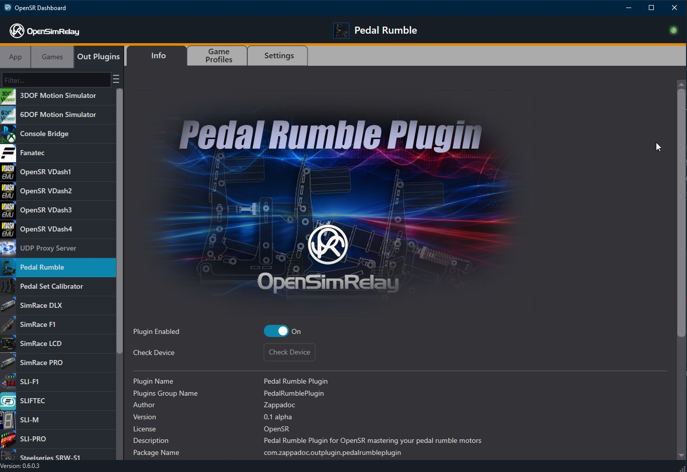
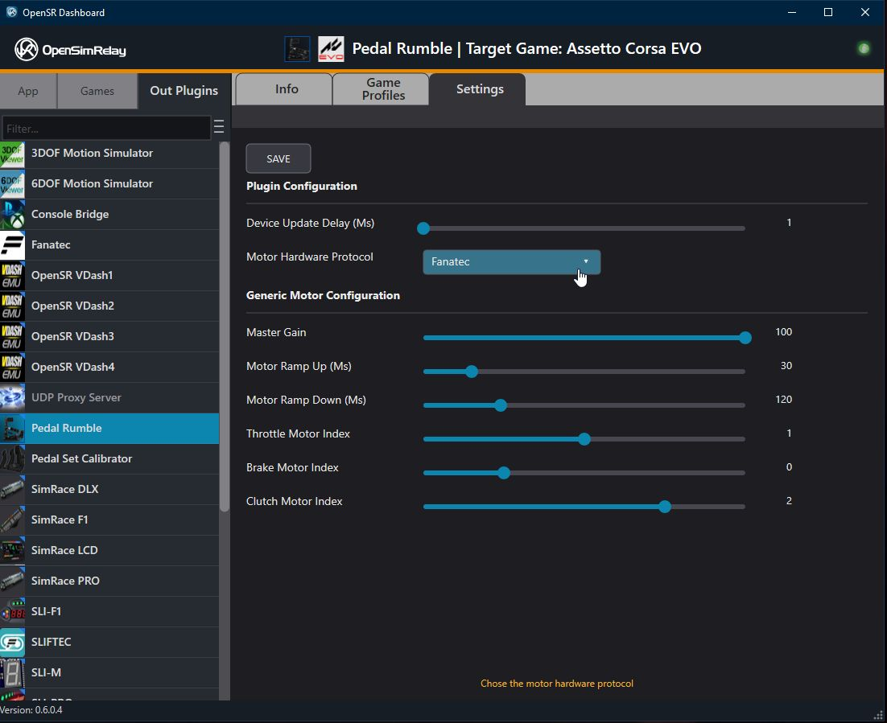
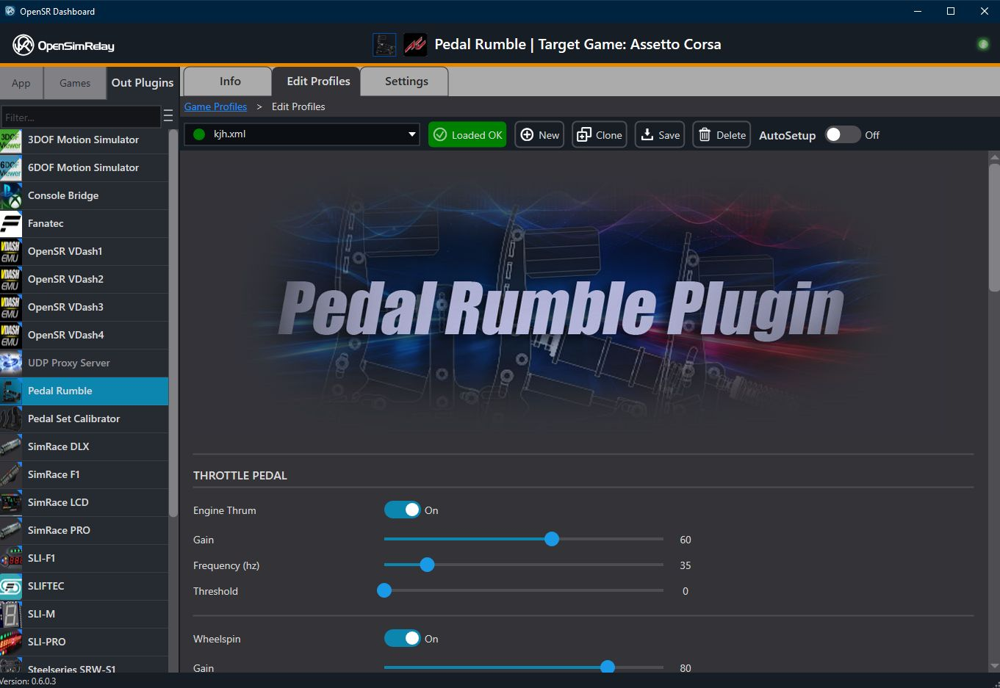

# Motor Hardware Protocol Developer Guide



This document provides the technical specifications for creating a motor hardware backend DLL for the OpenSR Pedal Rumble Plugin.

The plugin utilizes a provider pattern where motor hardware backends are loaded as dynamic link libraries (DLLs) at runtime. To support new hardware, you must implement the `IMotorHardware` interface.

## 1. Technical Requirements

- **Platform:** Windows x64
- **Format:** Dynamic Link Library (.dll)
- **Language:** C++ (Modern standard)
- **Linkage:** The DLL must export two specific factory functions using C linkage to avoid name mangling.

### Required DLL Exports

Your DLL must export the following two functions:

```c
extern "C" {
    __declspec(dllexport) IMotorHardware* CreateMotorHardware();
    __declspec(dllexport) void DestroyMotorHardware(IMotorHardware* pMHw);
}
```

- `CreateMotorHardware`: Allocates and returns a new instance of your hardware class.
- `DestroyMotorHardware`: Safely deletes the instance.

## 2. Installation and Configuration

### File Placement

Install the compiled DLL into the following directory:  
`OpenSR/OutPlugins/PedalRumblePlugin/MotorProtocol/[your_protocol].dll`

### Plugin Registration

The protocol is automatically recognized by OpenSR Dashboard.

Contact us to integrate your motor protocol DLL into our update system and installer to make it available to all users.



## 3. The IMotorHardware Interface

All hardware backends must inherit from the `IMotorHardware` base class.

```cpp
class IMotorHardware {
public:
    virtual ~IMotorHardware() = default;

    // Identity
    virtual void GetProtocolName(char* buffer, size_t bufferSize) const = 0;
    virtual void GetAuthor(char* buffer, size_t bufferSize) const { /* optional */ }
    virtual void GetVersion(char* buffer, size_t bufferSize) const { /* optional */ }
    virtual void GetDescription(char* buffer, size_t bufferSize) const { /* optional */ }

    // Capabilities
    virtual int GetMotorCount() const = 0;
    virtual const char* GetName() const = 0;

    // Role mapping
    virtual void SetRoleMapping(uint8_t role, int index) = 0;
    virtual int  GetRoleMapping(uint8_t role) const = 0;

    // Motor control (role-based)
    virtual void SetMotor(uint8_t role, int intensity) = 0;
    virtual int  GetMotor(uint8_t role) const = 0;

    // Motor control (index-based)
    virtual void SetMotorIndex(int index, int intensity) = 0;
    virtual int  GetMotorIndex(int index) const = 0;
    virtual void Submit() {} 

    // Global control
    virtual void MotorOff() = 0;
    virtual bool IsConnected() const = 0;

    // Lifecycle
    virtual bool Initialize() = 0;
    virtual void Close() = 0;
};
```

### Method Details

#### Identity and Capabilities

- **GetProtocolName**: Returns the name displayed in the UI (e.g., "Fanatec"). Max 31 characters.
- **GetAuthor / GetVersion / GetDescription**: Optional metadata used for debug logs.
- **GetMotorCount**: Returns the total number of physical motors available.
- **GetName**: Returns an internal hardware identifier (e.g., "fanatec_csp").

#### Role Mapping

The plugin uses a logical role system to decouple the haptic effects from the physical hardware.

- **Roles:** 0 = Throttle, 1 = Brake, 2 = Clutch.
- **SetRoleMapping**: Called during initialization. Maps a logical role to a physical motor index (0-based) or -1 if unassigned.
- **GetRoleMapping**: Returns the currently mapped motor index for a given role.

#### Motor Control

- **SetMotor**: The primary entry point for updates. You should use your internal role mapping to route the `intensity` (0 to 100) to the correct physical motor.
- **SetMotorIndex**: Direct control of a physical motor by its index.
- **GetMotor / GetMotorIndex**: Returns current intensity (0-100) or -1 if invalid. These are used to drive the visual meters in the UI.
- **Submit**: Optional. Use this to flush buffered commands to the hardware. This is called once per frame after all `SetMotor` calls.

#### Lifecycle and Global

- **Initialize**: Opens the device handle and prepares the hardware. Return `true` if successful.
- **IsConnected**: Polled every frame. If it returns `false`, the plugin stops sending commands.
- **MotorOff**: Immediately sets all motors to 0 intensity. Called during pauses or shutdown.
- **Close**: Releases hardware handles. No other methods will be called after this.

## 4. Reference Implementation

For a minimal working example, refer to the **TestMode** implementation provided in the OpenSR SDK.

The files `TestMotor.h` and `TestMotor.cpp` demonstrate:

- How to inherit from `IMotorHardware`.
- How to implement basic role-to-index mapping.
- How to handle the `CreateMotorHardware` and `DestroyMotorHardware` exports.
- How to clamp intensity values and handle basic device lifecycle.

## 5. Execution Lifecycle

The plugin manages the DLL instance through the following sequence:

1. **Loading Phase:**  
   `CreateMotorHardware()` $\rightarrow$ `Initialize()` $\rightarrow$ `SetRoleMapping()` for each role.
2. **Active Loop (10ms to 100ms interval):**  
   `SetMotor()` (per role) $\rightarrow$ `Submit()` $\rightarrow$ `IsConnected()`.
3. **Pause State:**  
   `MotorOff()` is called when the game is paused.
4. **Shutdown / Change Phase:**  
   `MotorOff()` $\rightarrow$ `Close()` $\rightarrow$ `DestroyMotorHardware()`.

## 6. Implementation Guidelines

### Intensity Convention

- **Range:** Integer values from 0 (off) to 100 (full power).
- **Smoothing:** The plugin applies attack and decay ramp smoothing before calling `SetMotor`. Hardware developers should not apply additional smoothing.

### Implementation Checklist

1. Create a x64 DLL project in Visual Studio.
2. Study `TestMotor.h` and `TestMotor.cpp` in the SDK for the basic pattern.
3. Inherit from `IMotorHardware`.
4. Implement `Initialize` to detect and open your hardware.
5. Implement `SetMotorIndex` to translate the 0-100 value to your hardware's specific protocol.
6. Implement `MotorOff` and `Close` for safe cleanup.
7. Export `CreateMotorHardware` and `DestroyMotorHardware`.
8. Deploy to the `MotorProtocol` folder and update `settings.xml`.

## Support and Partnership

If you require assistance with the implementation or wish for us to develop the integration for you, please contact us. We can provide full protocol development given access to a hardware unit and the relevant SDK or communication documentation.



```cpp
// TestMotor.h 
// TestMode.dll Generic Implementation
#pragma once
#include "IMotorHardware.h"
#include <atomic>
#include <array>

class TestMotor : public IMotorHardware {
public:
    TestMotor() = default;
    ~TestMotor() override = default;

    // Identity
    void GetProtocolName(char* buffer, size_t bufferSize) const override;
    void GetAuthor(char* buffer, size_t bufferSize) const override;
    void GetVersion(char* buffer, size_t bufferSize) const override;
    void GetDescription(char* buffer, size_t bufferSize) const override;

    // Capabilities
    int GetMotorCount() const override { return m_motorCount; }
    const char* GetName() const override { return "Test (Console)"; }

    // Role mapping
    void SetRoleMapping(uint8_t role, int index) override;
    int  GetRoleMapping(uint8_t role) const override;

    // Motor control (role-based)
    void SetMotor(uint8_t role, int intensity) override;
    int  GetMotor(uint8_t role) const override;

    // Motor control (index-based)
    void SetMotorIndex(int index, int intensity) override;
    int  GetMotorIndex(int index) const override;
    void Submit() override {}

    // Global
    void MotorOff() override;
    bool IsConnected() const override { return m_connected; }

    // Lifecycle
    bool Initialize() override;
    void Close() override;

private:
    void Print(int index, int intensity);

    std::atomic<bool> m_connected{ false };
    int m_motorCount = 2;
    std::array<int, 3> m_roleMap = { 0, 1, -1 };
    std::array<int, 4> m_states = { 0, 0, 0, 0 };
    std::array<int, 4> m_lastPrinted = { -1, -1, -1, -1 };
};
```

```cpp
// TestMotor.cpp
// TestMode.dll Generic Implementation
#include "TestMotor.h"
#include <iostream>
#include <cstring>

void TestMotor::GetProtocolName(char* buffer, size_t bufferSize) const
{
    if (bufferSize == 0) return;
    strcpy_s(buffer, bufferSize, "Test");
}

void TestMotor::GetAuthor(char* buffer, size_t bufferSize) const
{
    if (bufferSize == 0) return;
    strcpy_s(buffer, bufferSize, "You");
}

void TestMotor::GetVersion(char* buffer, size_t bufferSize) const
{
    if (bufferSize == 0) return;
    strcpy_s(buffer, bufferSize, "1.0.0");
}

void TestMotor::GetDescription(char* buffer, size_t bufferSize) const
{
    if (bufferSize == 0) return;
    strncpy_s(buffer, bufferSize, "Console test motor - prints to stdout", _TRUNCATE);
}

void TestMotor::SetRoleMapping(uint8_t role, int index)
{
    if (role < 3) m_roleMap[role] = index;
}

int TestMotor::GetRoleMapping(uint8_t role) const
{
    if (role < 3) return m_roleMap[role];
    return -1;
}

void TestMotor::SetMotor(uint8_t role, int intensity)
{
    int idx = GetRoleMapping(role);
    if (idx < 0) return;
    SetMotorIndex(idx, intensity);
}

int TestMotor::GetMotor(uint8_t role) const
{
    int idx = GetRoleMapping(role);
    if (idx < 0) return -1;
    return GetMotorIndex(idx);
}

void TestMotor::SetMotorIndex(int index, int intensity)
{
    if (!m_connected || index < 0 || index >= m_motorCount) return;
    if (intensity < 0) intensity = 0;
    if (intensity > 100) intensity = 100;
    m_states[index] = intensity;
    Print(index, intensity);
}

int TestMotor::GetMotorIndex(int index) const
{
    if (index < 0 || index >= m_motorCount) return -1;
    return m_states[index];
}

void TestMotor::MotorOff()
{
    for (int i = 0; i < m_motorCount; i++) {
        m_states[i] = 0;
    }
    for (int i = 0; i < m_motorCount; i++) {
        Print(i, 0);
    }
}

bool TestMotor::Initialize()
{
    m_connected = true;
    std::cout << "[TestMotor] Initialized, " << m_motorCount << " motors" << std::endl;
    return true;
}

void TestMotor::Close()
{
    MotorOff();
    m_connected = false;
    std::cout << "[TestMotor] Closed" << std::endl;
}

void TestMotor::Print(int index, int intensity)
{
    if (m_lastPrinted[index] == intensity) return;
    m_lastPrinted[index] = intensity;
    std::cout << "[Motor " << index << "] " << intensity << "%" << std::endl;
}

extern "C" {
    __declspec(dllexport) IMotorHardware* CreateMotorHardware()
    {
        return new TestMotor();
    }

    __declspec(dllexport) void DestroyMotorHardware(IMotorHardware* pMHw)
    {
        delete pMHw;
    }
}
```
